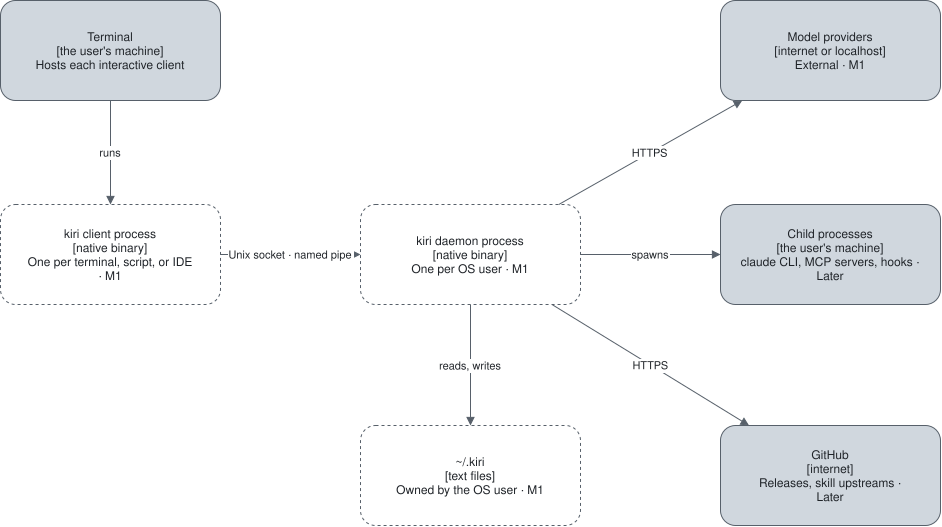

# Deployment

One environment: the user's machine. Nothing is hosted.

| Block | Runs as | Where | Milestone |
| --- | --- | --- | --- |
| `kiri` client | One process per terminal, script, or IDE | The user's machine | M1 |
| `kiri daemon` | One process per operating-system user | The user's machine | M1 |
| State | Text files under `~/.kiri` and `<project>/.kiri` | The user's disk | M1 |
| Child processes | The `claude` CLI, MCP servers, hooks | The user's machine | Later |

The transport between client and daemon is a Unix domain socket on Linux and macOS and a named pipe on
Windows, restricted to the owning user ([NFR-SEC-02](../requirements/non-functional/security.md#nfr-sec-02)).

## Packaging and install

Nothing is installable yet; distribution is `Later`. As planned in
[ADR 0002](../decisions/0002-stack.md) and [FR-DST](../requirements/functional/distribution.md):

- **One way to install:** a one-line script, `sh` on Linux and macOS and PowerShell on Windows, that
  downloads the release archive from GitHub Releases and checks its SHA-256.
- **Targets:** `x86_64` and `aarch64` of Linux (static musl), macOS, and Windows (MSVC).
- **Archive:** `.tar.gz` on Linux and macOS, `.zip` on Windows, holding `kiri`, `rg`, and on Linux `bwrap`.
- **Signatures:** every archive is signed with minisign. The macOS binary is signed with one fixed
  certificate of Kiri's own, so the Keychain keeps recognizing it across updates; Windows ships without
  Authenticode at first.
- **Updates:** `kiri` verifies the minisign signature and replaces its own executable
  ([FR-DST-05](../requirements/functional/distribution.md#fr-dst-05)).

## Delivery

- **Gates:** the repository's `gates` project skill.
- **CI:** `.github/workflows/ci.yml` runs the code gates on Windows, Linux, and macOS on every push. The cross-user check of `xtask` joins it with [#15](https://github.com/TheoOdawara/Kiri/issues/15).
- **Branches:** work branches merge into `staging` by pull request; a release is a merge of `staging` into `main`.
