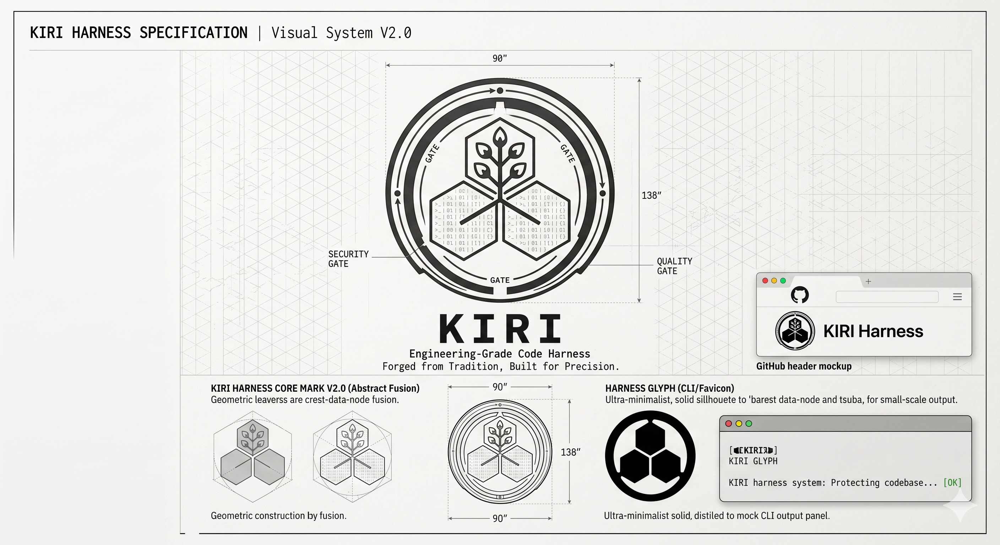

# Brand

The mark of Kiri, what it means, and every brand asset. What is kept as it is and what is open for
redesign is set in the [requirements overview](../../requirements/overview.md#constraints). The colors are
in [tokens](../tokens.md).

## The mark

The mark is the Kiri-Gate. It takes the *go-shichi-no-kiri*, the 5-7-5 paulownia crest of the Toyotomi
clan, and redraws it as the topology of an engineering system.

- The 5-7-5 structure of flowers and leaves is the chassis: a diagram of data flow and orchestration. The
  three leaves at its base are the foundations the system stands on: code, infra, and data.
- The ring around it comes from the *tsuba*, a katana's hand-guard. It is a containment ring, the quality
  gate the harness runs to keep code safe and fast.
- The drawing is vector, monochrome, and technical. It stands for discipline, production-grade safety,
  and tradition forged in steel, the opposite of "vibecoding".

## Assets

| File | What it is | Used in |
| --- | --- | --- |
| [logo.png](logo.png) | The full mark: the crest inside the tsuba, with its GATE labels | The repository's `README.md` |
| [icon.png](icon.png) | The glyph: three solid hexagons in the tsuba, for small sizes | The docs site's logo and favicon |
| [seal.txt](seal.txt) | The mark in block characters, with the tagline | The launch screen, [FR-UI-06](../../requirements/functional/interfaces.md#fr-ui-06) |
| [design.png](design.png) | The visual system sheet: construction, proportions, and the glyph | Reference |

