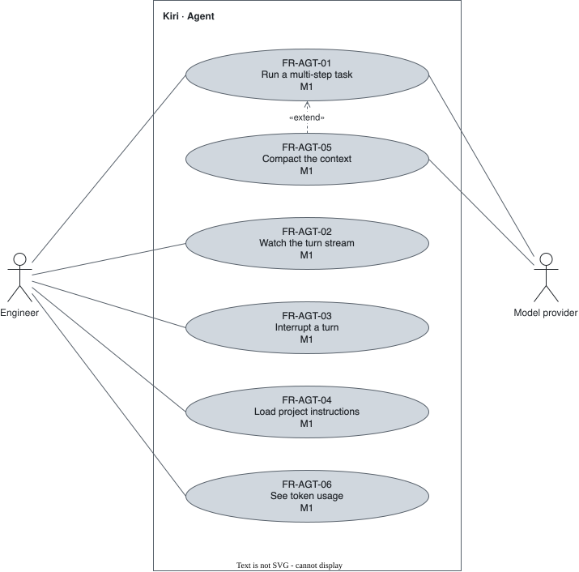

# Agent — `AGT`

The conversation loop between the user, the model, and the tools.

## FR-AGT-01 — Multi-turn loop {#fr-agt-01}

> As an engineer, I want the agent to keep reasoning and calling tools until it has an answer, so that one prompt completes a task that needs several steps.

The system shall run a turn as a loop in which the model reasons, calls tools, receives their results, and continues until it produces a final answer.

| Attribute | Value |
| --- | --- |
| Rationale | A coding task is rarely one model call. |
| Source | Author interview, 2026-09-30 |
| Priority | Must |
| Status | approved |
| Milestone | M1 |
| Since | v1.0.0 |

**Acceptance criteria:**

- **FR-AGT-01.1** — Given a configured provider, when the user sends a prompt that needs a tool, then the tool's result is returned to the model and the turn ends with an answer.

## FR-AGT-02 — Live streaming {#fr-agt-02}

> As an engineer, I want to see reasoning, text, and tool calls as they arrive, so that every step of the agent is visible while it happens.

The system shall stream the reasoning the provider exposes, the text, and the tool calls to the interface as they arrive from the provider.

| Attribute | Value |
| --- | --- |
| Rationale | Full control starts with seeing every step. |
| Source | Author interview, 2026-09-30 |
| Priority | Must |
| Status | approved |
| Milestone | M1 |
| Since | v1.0.0 |

**Acceptance criteria:**

- **FR-AGT-02.1** — Given a configured provider, when the model produces output, then the reasoning the provider exposes, the text, and the tool calls appear in arrival order before the turn ends.

## FR-AGT-03 — Turn interruption {#fr-agt-03}

> As an engineer, I want to interrupt a turn at any moment, so that I stop work that is going wrong without losing the conversation.

The system shall let the user interrupt a running turn at any moment while keeping the conversation.

| Attribute | Value |
| --- | --- |
| Rationale | The user keeps the wheel. |
| Source | Author interview, 2026-09-30 |
| Priority | Must |
| Status | approved |
| Milestone | M1 |
| Since | v1.0.0 |

**Acceptance criteria:**

- **FR-AGT-03.1** — Given a running turn, when the user interrupts it, then the turn stops and every earlier message of the conversation is available to the next prompt.
- **FR-AGT-03.2** — Given a turn running a shell command, when the user interrupts it, then the command and every process it started end.

## FR-AGT-04 — Project instructions {#fr-agt-04}

> As an engineer, I want the project's instruction files read at session start, so that the agent follows the project's rules without me repeating them.

The system shall load a trusted project's instruction files into the model's context when a session starts.

| Attribute | Value |
| --- | --- |
| Rationale | Project rules belong to the repository, not to each prompt. An untrusted project's instruction file is a prompt-injection path, so it waits for [FR-SAF-08](safety.md#fr-saf-08). Which file names are read is [OQ-04](../open-questions.md). |
| Source | Author interview, 2026-09-30 |
| Priority | Must |
| Status | approved |
| Milestone | M1 |
| Since | v1.0.0 |

**Acceptance criteria:**

- **FR-AGT-04.1** — Given a trusted project holding an instruction file, when a session starts in it, then the file's content is part of the context of the first turn.
- **FR-AGT-04.2** — Given an untrusted project holding an instruction file, when a session starts in it, then the file's content is not in the context.

## FR-AGT-05 — Context compaction {#fr-agt-05}

> As an engineer, I want a long conversation compacted before it overflows the model's context, so that a day of work fits in one session.

The system shall compact the conversation, visibly in the transcript, when the next request would exceed the current model's context window.

| Attribute | Value |
| --- | --- |
| Rationale | Daily use outgrows any context window. The compaction is shown because nothing happens out of the user's sight. |
| Source | Author decision, review 2026-10-26 |
| Priority | Must |
| Status | approved |
| Milestone | M1 |
| Since | v2.0.0 |

**Acceptance criteria:**

- **FR-AGT-05.1** — Given a conversation whose next request would exceed the current model's context window, when the user sends a prompt, then the conversation is compacted, the transcript shows that it was, and the turn completes.

## FR-AGT-06 — Token usage {#fr-agt-06}

> As an engineer, I want to see the tokens each turn and the session consume, so that I know what my work costs.

The system shall show the user the input and output tokens of each turn and the session's running total.

| Attribute | Value |
| --- | --- |
| Rationale | Full control includes what the work costs. |
| Source | Author decision, review 2026-10-26 |
| Priority | Must |
| Status | approved |
| Milestone | M1 |
| Since | v2.0.0 |

**Acceptance criteria:**

- **FR-AGT-06.1** — Given a provider that reports usage, when a turn ends, then the user sees the turn's input and output tokens and the session's total.
