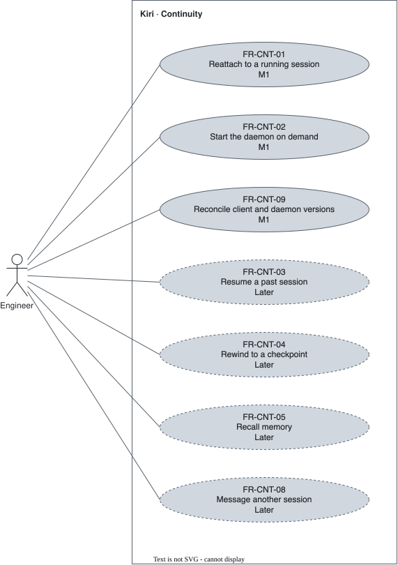

# Continuity — `CNT`

What outlives a terminal and a session.

## FR-CNT-01 — Sessions survive the terminal {#fr-cnt-01}

> As an engineer, I want a running session to outlive my terminal, so that closing a window never kills work in progress.

The system shall keep a running session alive when its terminal closes and let the user reattach to it.

| Attribute | Value |
| --- | --- |
| Rationale | The daemon owns every session. A session with no running turn is not kept after the daemon exits until [FR-CNT-03](#fr-cnt-03) ships. "Running session" is defined in the [glossary](../glossary.md). |
| Source | [ADR 0001](../../decisions/0001-architecture.md); review 2026-10-26 |
| Priority | Must |
| Status | approved |
| Milestone | M1 |
| Since | v1.0.0 |

**Acceptance criteria:**

- **FR-CNT-01.1** — Given a running session, when the user closes the terminal and opens Kiri again, then the session is still running and the user reattaches to it.
- **FR-CNT-01.2** — Given two or more running sessions in a project, when the user opens Kiri there, then the user picks which one to reattach to.
- **FR-CNT-01.3** — Given a turn waiting for an approval when its terminal closes, when the user reattaches, then the approval is shown and the turn has not moved past it.

## FR-CNT-02 — Daemon on demand {#fr-cnt-02}

> As an engineer, I want the daemon started for me, so that I never manage a background process.

The system shall start the daemon when the first client needs it, with no action from the user.

| Attribute | Value |
| --- | --- |
| Rationale | One daemon per user, started by the first client. |
| Source | [ADR 0001](../../decisions/0001-architecture.md) |
| Priority | Must |
| Status | approved |
| Milestone | M1 |
| Since | v1.0.0 |

**Acceptance criteria:**

- **FR-CNT-02.1** — Given no daemon running, when the user opens Kiri, then a session starts with no separate command.

## FR-CNT-03 — List and resume sessions {#fr-cnt-03}

> As an engineer, I want to list and resume past conversations of a project, so that I continue yesterday's work.

The system shall list a project's past sessions and resume the one the user picks.

| Attribute | Value |
| --- | --- |
| Rationale | Work spans days. |
| Source | Author interview, 2026-09-30 |
| Priority | Won't (this release) |
| Status | approved |
| Milestone | Later |
| Since | v1.0.0 |

**Acceptance criteria:**

- **FR-CNT-03.1** — Given a past session, when the user resumes it, then the conversation continues where it stopped.

## FR-CNT-04 — Checkpoints and rewind {#fr-cnt-04}

> As an engineer, I want to roll the agent's file edits back, so that a wrong direction costs nothing.

The system shall roll the agent's file edits back to a point of the conversation the user picks.

| Attribute | Value |
| --- | --- |
| Rationale | Control includes undo. |
| Source | Author interview, 2026-09-30 |
| Priority | Won't (this release) |
| Status | approved |
| Milestone | Later |
| Since | v1.0.0 |

**Acceptance criteria:**

- **FR-CNT-04.1** — Given agent edits made after a checkpoint, when the user rewinds to it, then the files return to their content at that point.

## FR-CNT-05 — Persistent memory {#fr-cnt-05}

> As an engineer, I want the agent to keep facts and preferences, so that I do not repeat myself in every session.

The system shall keep facts and preferences across sessions and make them available to the agent.

| Attribute | Value |
| --- | --- |
| Rationale | A session starts from what earlier ones learned. |
| Source | Author interview, 2026-09-30 |
| Priority | Won't (this release) |
| Status | approved |
| Milestone | Later |
| Since | v1.0.0 |

**Acceptance criteria:**

- **FR-CNT-05.1** — Given a fact stored in memory, when a later session needs it, then the agent recalls it.

## FR-CNT-06 — Sync across machines {#fr-cnt-06}

> As an engineer, I want my configuration, memory, and extensions on every machine, so that each machine behaves the same.

The system shall sync configuration, memory, and extensions under `~/.kiri` across the user's machines through a private GitHub repository.

| Attribute | Value |
| --- | --- |
| Rationale | The user works on more than one machine. |
| Source | Author interview, 2026-09-30 |
| Priority | Won't (this release) |
| Status | retired |
| Milestone | Later |
| Since | v1.0.0 |
| Retired | v3.0.0: the author dropped sync across machines (2026-10-27) |

**Acceptance criteria:**

- **FR-CNT-06.1** — Given two machines with sync on, when memory or extensions change on one, then the other receives the change.

## FR-CNT-07 — Sync setup offer {#fr-cnt-07}

> As an engineer, I want sync offered at first run, so that I turn it on in one step or skip it.

The system shall offer, at first run, to create the sync repository, using `gh` when it is installed, and work fully when the user declines.

| Attribute | Value |
| --- | --- |
| Rationale | Sync is optional. |
| Source | Author interview, 2026-09-30 |
| Priority | Won't (this release) |
| Status | retired |
| Milestone | Later |
| Since | v1.0.0 |
| Retired | v3.0.0: the author dropped sync across machines (2026-10-27) |

**Acceptance criteria:**

- **FR-CNT-07.1** — Given a first run, when the user declines creating the sync repository, then Kiri works normally.
- **FR-CNT-07.2** — Given sync declined at first run, when the user enables it later, then sync starts.

## FR-CNT-08 — Session-to-session messaging {#fr-cnt-08}

> As an engineer, I want sessions to message each other, so that parallel work coordinates.

The system shall let a session send a message to another session of the same user.

| Attribute | Value |
| --- | --- |
| Rationale | Wanted in the base of the architecture. |
| Source | [ADR 0001](../../decisions/0001-architecture.md) |
| Priority | Won't (this release) |
| Status | approved |
| Milestone | Later |
| Since | v1.0.0 |

**Acceptance criteria:**

- **FR-CNT-08.1** — Given two running sessions, when one sends a message to the other, then the other receives it.

## FR-CNT-09 — Client and daemon versions {#fr-cnt-09}

> As an engineer, I want a new Kiri to work after an update while an old daemon still runs, so that updating never leaves me with a broken session.

The system shall, when a client connects to a daemon of another version, replace the daemon if no session is running, and otherwise tell the user.

| Attribute | Value |
| --- | --- |
| Rationale | The daemon outlives the binary it was started from: every rebuild or update leaves an older daemon running. |
| Source | Author decision, review 2026-10-26 |
| Priority | Must |
| Status | approved |
| Milestone | M1 |
| Since | v2.0.0 |

**Acceptance criteria:**

- **FR-CNT-09.1** — Given a daemon of another version with no running session, when a client connects, then the daemon is replaced by one of the client's version and the session starts.
- **FR-CNT-09.2** — Given a daemon of another version with a running session, when a client connects, then the user sees both versions and the running session is not interrupted.
