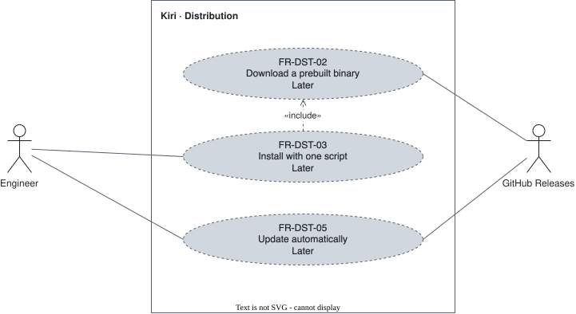

# Distribution — `DST`

How Kiri reaches a user's machine and stays current.

## FR-DST-01 — Cargo install {#fr-dst-01}

> As an engineer, I want to install with `cargo install`, so that a Rust developer needs nothing else.

The system shall be installable with `cargo install`.

| Attribute | Value |
| --- | --- |
| Rationale | The shortest path for a Rust user. |
| Source | Author interview, 2026-09-30 |
| Priority | Won't (this release) |
| Status | retired |
| Milestone | Later |
| Since | v1.0.0 |
| Retired | v3.0.0: the install script is the only way to install (2026-10-27) |

**Acceptance criteria:**

- **FR-DST-01.1** — Given a Rust toolchain, when the user runs `cargo install` for Kiri, then the `kiri` binary runs.

## FR-DST-02 — Prebuilt binaries {#fr-dst-02}

> As an engineer, I want prebuilt binaries, so that I install without a Rust toolchain.

The system shall publish prebuilt binaries for Windows, Linux, and macOS on GitHub Releases.

| Attribute | Value |
| --- | --- |
| Rationale | Most users do not compile. |
| Source | Author interview, 2026-09-30 |
| Priority | Won't (this release) |
| Status | approved |
| Milestone | Later |
| Since | v1.0.0 |

**Acceptance criteria:**

- **FR-DST-02.1** — Given a release, when it is published, then it holds one binary for each of the three platforms.

## FR-DST-03 — Install script {#fr-dst-03}

> As an engineer, I want a one-line install, so that setup is one command.

The system shall provide a one-line install script that fetches the prebuilt binary: `sh` on Linux and macOS, PowerShell on Windows.

| Attribute | Value |
| --- | --- |
| Rationale | Onboarding for someone new. |
| Source | Author interview, 2026-09-30 |
| Priority | Won't (this release) |
| Status | approved |
| Milestone | Later |
| Since | v1.0.0 |

**Acceptance criteria:**

- **FR-DST-03.1** — Given a machine without Kiri, when the user runs the install script for its platform, then the `kiri` binary runs.

## FR-DST-04 — Package managers {#fr-dst-04}

> As an engineer, I want to install from my package manager, so that Kiri updates with the rest of my system.

The system shall be installable from winget, scoop, Homebrew, and Linux packages.

| Attribute | Value |
| --- | --- |
| Rationale | Each platform has its habit. |
| Source | Author interview, 2026-09-30 |
| Priority | Won't (this release) |
| Status | retired |
| Milestone | Later |
| Since | v1.0.0 |
| Retired | v3.0.0: the install script is the only way to install (2026-10-27) |

**Acceptance criteria:**

- **FR-DST-04.1** — Given each listed package manager, when the user installs Kiri through it, then the `kiri` binary runs.

## FR-DST-05 — Auto-update {#fr-dst-05}

> As an engineer, I want Kiri to update itself, so that I stay on the current release.

The system shall replace itself with a new release when one is published.

| Attribute | Value |
| --- | --- |
| Rationale | Releases reach users without manual work. |
| Source | Author interview, 2026-09-30 |
| Priority | Won't (this release) |
| Status | approved |
| Milestone | Later |
| Since | v1.0.0 |

**Acceptance criteria:**

- **FR-DST-05.1** — Given a new release, when auto-update runs, then Kiri replaces itself with the new version.
