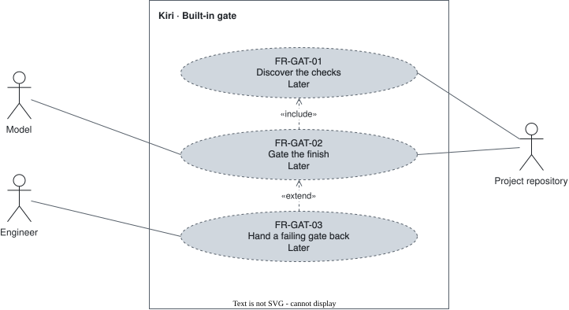

# Built-in gate — `GAT`

The gate that keeps the agent from finishing on red checks.

## FR-GAT-01 — Check discovery {#fr-gat-01}

> As an engineer, I want the repository's own checks discovered, so that the gate needs no setup.

The system shall discover the repository's own checks: format, lint, typecheck, build, and test.

| Attribute | Value |
| --- | --- |
| Rationale | The repository already defines what green means. |
| Source | Author interview, 2026-09-30 |
| Priority | Won't (this release) |
| Status | approved |
| Milestone | Later |
| Since | v1.0.0 |

**Acceptance criteria:**

- **FR-GAT-01.1** — Given a repository with configured checks, when the gate starts, then it lists each check it found with the command that runs it.

## FR-GAT-02 — Gate before finish {#fr-gat-02}

> As an engineer, I want the gate run before the agent declares work finished, so that "done" is never declared on a red build.

The system shall run the gate before the agent declares work finished and return a failure to the agent.

| Attribute | Value |
| --- | --- |
| Rationale | The agent cannot declare work finished while the checks are red. |
| Source | Author interview, 2026-09-30 |
| Priority | Won't (this release) |
| Status | approved |
| Milestone | Later |
| Since | v1.0.0 |

**Acceptance criteria:**

- **FR-GAT-02.1** — Given red checks, when the agent tries to finish, then it receives the failure and continues working.
- **FR-GAT-02.2** — Given green checks, when the agent tries to finish, then the turn ends.

## FR-GAT-03 — Attempt budget {#fr-gat-03}

> As an engineer, I want the self-correction bounded, so that a gate the agent cannot fix returns to me.

The system shall hand control to the user with the failure when the gate's attempt budget is spent.

| Attribute | Value |
| --- | --- |
| Rationale | Self-correction without a bound never ends. |
| Source | Author interview, 2026-09-30 |
| Priority | Won't (this release) |
| Status | approved |
| Milestone | Later |
| Since | v1.0.0 |

**Acceptance criteria:**

- **FR-GAT-03.1** — Given a gate still failing, when the attempt budget is spent, then the agent stops and the user sees the failure.
