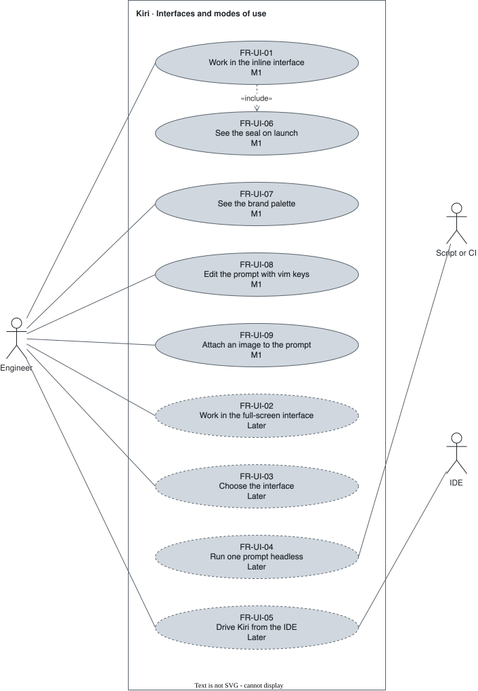

# Interfaces and modes of use — `UI`

The front-ends a user drives Kiri from, and the brand they carry.

## FR-UI-01 — Inline interface {#fr-ui-01}

> As an engineer, I want the conversation in my terminal's scrollback, so that I scroll, select, and copy with the terminal's own tools.

The system shall provide an inline interactive interface whose transcript lives in the terminal's native scrollback.

| Attribute | Value |
| --- | --- |
| Rationale | Milestone 1's interface. |
| Source | Author interview, 2026-09-30 |
| Priority | Must |
| Status | approved |
| Milestone | M1 |
| Since | v1.0.0 |

**Acceptance criteria:**

- **FR-UI-01.1** — Given the inline interface, when a session runs, then the transcript stays in the terminal's native scrollback.

## FR-UI-02 — Full-screen interface {#fr-ui-02}

> As an engineer, I want a full-screen interface, so that the layout uses the whole terminal.

The system shall provide a full-screen interactive interface on the terminal's alternate screen.

| Attribute | Value |
| --- | --- |
| Rationale | Full layout control. |
| Source | Author interview, 2026-09-30 |
| Priority | Won't (this release) |
| Status | approved |
| Milestone | Later |
| Since | v1.0.0 |

**Acceptance criteria:**

- **FR-UI-02.1** — Given the full-screen interface, when a session runs, then it runs in the alternate screen and the previous terminal content returns on exit.

## FR-UI-03 — Interface choice {#fr-ui-03}

> As an engineer, I want to choose between inline and full-screen, so that I use the one that fits my terminal habits.

The system shall let the user choose which interactive interface a session opens in.

| Attribute | Value |
| --- | --- |
| Rationale | Both interfaces serve the same engine. |
| Source | Author interview, 2026-09-30 |
| Priority | Won't (this release) |
| Status | approved |
| Milestone | Later |
| Since | v1.0.0 |

**Acceptance criteria:**

- **FR-UI-03.1** — Given both interfaces available, when the user chooses one, then the session opens in it.

## FR-UI-04 — Headless mode {#fr-ui-04}

> As an engineer, I want to run one prompt without an interface, so that Kiri works from scripts and CI.

The system shall run one prompt through `kiri -p` with text or JSON output and no interactive interface.

| Attribute | Value |
| --- | --- |
| Rationale | Scripts and CI have no terminal user. |
| Source | Author interview, 2026-09-30 |
| Priority | Won't (this release) |
| Status | approved |
| Milestone | Later |
| Since | v1.0.0 |

**Acceptance criteria:**

- **FR-UI-04.1** — Given `kiri -p "<prompt>"`, when it runs, then it prints the result with no interactive interface and exits with status zero.
- **FR-UI-04.2** — Given `kiri -p` and a failed turn, when it ends, then the exit status is non-zero.

## FR-UI-05 — IDE integration {#fr-ui-05}

> As an engineer, I want to drive Kiri from my IDE, so that I stay in the editor.

The system shall let an ACP-capable IDE drive the agent through `kiri acp`.

| Attribute | Value |
| --- | --- |
| Rationale | ACP (Agent Client Protocol) is the engine's boundary. |
| Source | [ADR 0001](../../decisions/0001-architecture.md) |
| Priority | Won't (this release) |
| Status | approved |
| Milestone | Later |
| Since | v1.0.0 |

**Acceptance criteria:**

- **FR-UI-05.1** — Given an ACP-capable IDE, when it connects to Kiri, then the user sends prompts and approves actions from the IDE.

## FR-UI-06 — Seal on launch {#fr-ui-06}

> As an engineer, I want the Kiri seal on launch, so that the product is recognisable.

The system shall show the Kiri-Gate seal of `docs/design/brand/seal.txt`, centered, with the tagline beneath it, when an interactive interface launches.

| Attribute | Value |
| --- | --- |
| Rationale | The brand is the one thing preserved from the previous codebase. |
| Source | Author interview, 2026-09-30 |
| Priority | Must |
| Status | approved |
| Milestone | M1 |
| Since | v1.0.0 |

**Acceptance criteria:**

- **FR-UI-06.1** — Given an interactive interface, when it launches, then the seal appears centered with the tagline beneath it.

## FR-UI-07 — Brand palette {#fr-ui-07}

> As an engineer, I want the interface in the brand's palette, so that it reads as Kiri.

The system shall render the interactive interfaces in the brand palette.

| Attribute | Value |
| --- | --- |
| Rationale | "Tamahagane Void" is the starting point; the redesigned palette is settled in the interface's spec. |
| Source | Author interview, 2026-09-30 |
| Priority | Must |
| Status | approved |
| Milestone | M1 |
| Since | v1.0.0 |

**Acceptance criteria:**

- **FR-UI-07.1** — Given a truecolor terminal, when an interactive interface renders, then every color it uses belongs to the brand palette.

## FR-UI-08 — Vim editing {#fr-ui-08}

> As an engineer, I want to edit my prompt with vim keys, so that I write and fix a prompt without leaving my habits.

The system shall offer vim-style modal editing of the prompt in the interactive interfaces, turned on in configuration.

| Attribute | Value |
| --- | --- |
| Rationale | The author edits in vim. The modes, motions, and operators are settled in the interface's spec. |
| Source | Author interview, 2026-10-27 |
| Priority | Must |
| Status | approved |
| Milestone | M1 |
| Since | v3.0.0 |

**Acceptance criteria:**

- **FR-UI-08.1** — Given vim editing on, when the user presses Esc in the prompt, then the prompt enters normal mode and a motion key moves the cursor instead of inserting text.
- **FR-UI-08.2** — Given vim editing off, which is the default, when the user types in the prompt, then every key inserts text.

## FR-UI-09 — Images in the prompt {#fr-ui-09}

> As an engineer, I want to paste or drop an image into my prompt, so that the model sees a screenshot or a mockup.

The system shall attach an image to the prompt from the clipboard or from a file dragged into the terminal.

| Attribute | Value |
| --- | --- |
| Rationale | Screenshots are part of daily work, and pasting one in Claude Code on Windows takes seconds or fails. |
| Source | Author interview, 2026-10-27 |
| Priority | Must |
| Status | approved |
| Milestone | M1 |
| Since | v3.0.0 |

**Acceptance criteria:**

- **FR-UI-09.1** — Given an image in the clipboard on Linux, macOS, or Windows, when the user pastes it, then the prompt shows the image attached within 1 second.
- **FR-UI-09.2** — Given an image file dragged into the terminal, when the prompt receives its path, then the image is attached.
- **FR-UI-09.3** — Given a model that does not accept images, when the user sends a prompt with an image, then Kiri says so and sends nothing.
