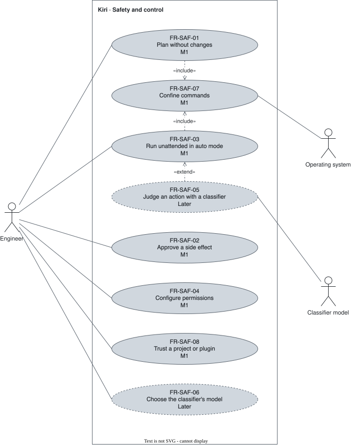

# Safety and control — `SAF`

Approval modes, permissions, the classifier, OS confinement, and trust.

## FR-SAF-01 — Plan mode {#fr-saf-01}

> As an engineer, I want a read-only mode, so that the agent investigates and plans without changing anything.

The system shall keep plan mode from changing the user's files: it refuses every file edit and write, and runs shell commands as auto mode does, under read-only OS confinement.

| Attribute | Value |
| --- | --- |
| Rationale | Planning carries no risk. Kiri cannot tell from a command's text whether it writes, so the operating system enforces it ([FR-SAF-07](#fr-saf-07)). Investigating should not stop for approvals, so commands follow auto mode's rules ([FR-SAF-03](#fr-saf-03)), network included. Claude Code offers this as an option; in Kiri it is how plan mode works. |
| Source | Author interview, 2026-09-30; review 2026-10-26; OQ-09 settled 2026-10-27 |
| Priority | Must |
| Status | approved |
| Milestone | M1 |
| Since | v1.0.0 |

**Acceptance criteria:**

- **FR-SAF-01.1** — Given plan mode, when the model attempts a file edit or write, then it is refused and the file is unchanged.
- **FR-SAF-01.2** — Given plan mode, when the model runs a command that writes a file, then the operating system stops the write and the file is unchanged.
- **FR-SAF-01.3** — Given plan mode, when the model runs a command, then it runs, asks, or is blocked exactly as it would in auto mode, network access included, with the user's files read-only.

## FR-SAF-02 — Default mode {#fr-saf-02}

> As an engineer, I want to be asked before any side effect, so that nothing changes without my approval.

The system shall ask the user, in default mode, before any side effect that no permission rule allows.

| Attribute | Value |
| --- | --- |
| Rationale | Nothing with side effects runs without the user's policy allowing it. A rule of [FR-SAF-04](#fr-saf-04) is that policy, so it applies in default mode too. |
| Source | Author interview, 2026-09-30; review 2026-10-26 |
| Priority | Must |
| Status | approved |
| Milestone | M1 |
| Since | v1.0.0 |

**Acceptance criteria:**

- **FR-SAF-02.1** — Given default mode, when the model proposes a side effect that no permission rule allows, then nothing runs until the user approves.
- **FR-SAF-02.2** — Given default mode and a permission rule that allows an action, when the model proposes it, then it runs without asking.

## FR-SAF-03 — Auto mode {#fr-saf-03}

> As an engineer, I want a mode that acts without asking, so that routine work proceeds unattended inside limits I set.

The system shall act, in auto mode, without asking, within the permissions, the sandbox when present, and the classifier when one is configured.

| Attribute | Value |
| --- | --- |
| Rationale | From Milestone 1, auto mode is bounded by the sandbox of [FR-SAF-07](#fr-saf-07) and the permissions of [FR-SAF-04](#fr-saf-04). |
| Source | Author decision, kickoff 2026-10-03; review 2026-10-26 |
| Priority | Must |
| Status | approved |
| Milestone | M1 |
| Since | v1.0.0 |

**Acceptance criteria:**

- **FR-SAF-03.1** — Given auto mode with no classifier configured, when the model proposes an action, then the sandbox and the configured permissions alone decide whether it runs, asks, or is blocked.
- **FR-SAF-03.2** — Given auto mode and an action the permissions block, when the model proposes it, then it does not run.

## FR-SAF-04 — Configurable permissions {#fr-saf-04}

> As an engineer, I want to configure which actions run, ask, or are blocked, so that my policy applies without repeating approvals.

The system shall let the user configure, globally and per project, which actions run, ask, or are blocked.

| Attribute | Value |
| --- | --- |
| Rationale | Permissions are the user's policy; in Milestone 1 they bound auto mode. |
| Source | Author decision, kickoff 2026-10-03 |
| Priority | Must |
| Status | approved |
| Milestone | M1 |
| Since | v1.0.0 |

**Acceptance criteria:**

- **FR-SAF-04.1** — Given a global rule that blocks an action, when the model proposes it in any project, then it is blocked.
- **FR-SAF-04.2** — Given a project rule, when the model proposes the action in another project, then the rule does not apply.

## FR-SAF-05 — Auto-mode classifier {#fr-saf-05}

> As an engineer, I want an optional classifier judging each action in auto mode, so that unsafe actions stop even when I am not watching.

The system shall let an optional classifier decide, in auto mode, per action: run, ask the user, or block.

| Attribute | Value |
| --- | --- |
| Rationale | Reference behavior: Jev (TypeSafe AI), which scores each call with session context and flags prompt injection in tool results. |
| Source | Author interview, 2026-09-30 |
| Priority | Won't (this release) |
| Status | approved |
| Milestone | Later |
| Since | v1.0.0 |

**Acceptance criteria:**

- **FR-SAF-05.1** — Given auto mode with a classifier, when the classifier judges an action unsafe, then the action is blocked or escalated to the user.

## FR-SAF-06 — Classifier model choice {#fr-saf-06}

> As an engineer, I want to pick the classifier's model, so that I use a model I already have.

The system shall let the user pick the classifier's model among every configured model.

| Attribute | Value |
| --- | --- |
| Rationale | No paid or remote service is imposed. |
| Source | Author interview, 2026-09-30 |
| Priority | Won't (this release) |
| Status | approved |
| Milestone | Later |
| Since | v1.0.0 |

**Acceptance criteria:**

- **FR-SAF-06.1** — Given two configured models, when the user picks one as the classifier, then classifier decisions come from that model.

## FR-SAF-07 — OS confinement {#fr-saf-07}

> As an engineer, I want commands confined by the operating system, so that a command cannot reach outside the allowed area.

The system shall run commands inside OS-level confinement on Windows (native mechanism), Linux, and macOS.

| Attribute | Value |
| --- | --- |
| Rationale | A policy the OS enforces holds against a wrong or hostile command. It is Milestone 1 because a permission matched against a command's text does not bound a shell: `sh -c` runs anything. |
| Source | Author interview, 2026-09-30; review 2026-10-26 |
| Priority | Must |
| Status | approved |
| Milestone | M1 |
| Since | v1.0.0 |

**Acceptance criteria:**

- **FR-SAF-07.1** — Given the sandbox, when a command tries to write outside the allowed area, then the operating system stops it — on Windows, on Linux, and on macOS.

## FR-SAF-08 — Trust approval {#fr-saf-08}

> As an engineer, I want to approve a project or plugin before it takes effect, so that an untrusted repository cannot act on my machine.

The system shall apply configuration and extensions supplied by a project or a plugin only after the user approves trust in it.

| Attribute | Value |
| --- | --- |
| Rationale | Enforces [BR-02](../business-rules.md#br-02). Needed in Milestone 1 because FR-SAF-04 reads project-level permissions. |
| Source | Author interview, 2026-09-30 |
| Priority | Must |
| Status | approved |
| Milestone | M1 |
| Since | v1.0.0 |

**Acceptance criteria:**

- **FR-SAF-08.1** — Given a project the user has not trusted, when Kiri starts in it, then none of its configuration or extensions is active until the user approves.
- **FR-SAF-08.2** — Given an untrusted repository whose configuration tries to loosen safety or redirect a credential, when Kiri loads it, then the attempt is ignored and reported to the user.
