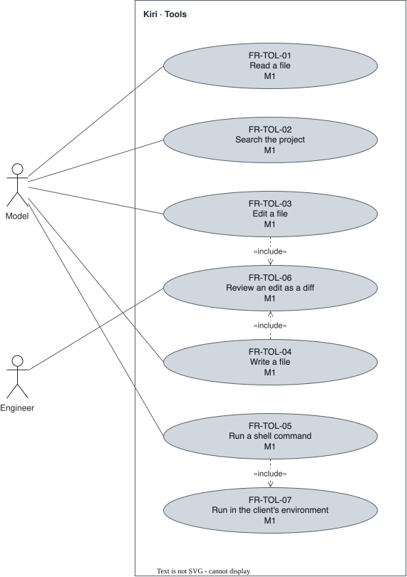

# Tools — `TOL`

The built-in tools the agent acts through.

## FR-TOL-01 — Read files {#fr-tol-01}

> As an engineer, I want the agent to read files, so that it works from the real code.

The system shall provide a tool that reads a file's content.

| Attribute | Value |
| --- | --- |
| Rationale | The agent needs the code to reason about it. |
| Source | Author interview, 2026-09-30 |
| Priority | Must |
| Status | approved |
| Milestone | M1 |
| Since | v1.0.0 |

**Acceptance criteria:**

- **FR-TOL-01.1** — Given an existing file, when the model calls the read tool on it, then the file's content is returned to the model.

## FR-TOL-02 — Search files {#fr-tol-02}

> As an engineer, I want the agent to search the project, so that it finds the code a task touches.

The system shall provide a tool that searches the project's files.

| Attribute | Value |
| --- | --- |
| Rationale | A task starts by locating the code. |
| Source | Author interview, 2026-09-30 |
| Priority | Must |
| Status | approved |
| Milestone | M1 |
| Since | v1.0.0 |

**Acceptance criteria:**

- **FR-TOL-02.1** — Given a project, when the model calls the search tool with a query, then the matching locations are returned to the model.

## FR-TOL-03 — Edit files {#fr-tol-03}

> As an engineer, I want the agent to change part of a file, so that it applies a targeted change.

The system shall provide a tool that edits part of an existing file.

| Attribute | Value |
| --- | --- |
| Rationale | Most changes touch part of a file. |
| Source | Author interview, 2026-09-30 |
| Priority | Must |
| Status | approved |
| Milestone | M1 |
| Since | v1.0.0 |

**Acceptance criteria:**

- **FR-TOL-03.1** — Given an existing file and an allowed edit, when the model calls the edit tool, then the file holds the change and the rest of it is untouched.

## FR-TOL-04 — Write files {#fr-tol-04}

> As an engineer, I want the agent to create or replace a file, so that it adds new code.

The system shall provide a tool that writes a whole file.

| Attribute | Value |
| --- | --- |
| Rationale | New files have nothing to edit. |
| Source | Author interview, 2026-09-30 |
| Priority | Must |
| Status | approved |
| Milestone | M1 |
| Since | v1.0.0 |

**Acceptance criteria:**

- **FR-TOL-04.1** — Given an allowed write, when the model calls the write tool, then the file exists with the given content.

## FR-TOL-05 — Run shell commands {#fr-tol-05}

> As an engineer, I want the agent to run shell commands, so that it builds, tests, and inspects the project.

The system shall provide a tool that runs a shell command.

| Attribute | Value |
| --- | --- |
| Rationale | The repository's own tooling is driven from the shell. |
| Source | Author interview, 2026-09-30 |
| Priority | Must |
| Status | approved |
| Milestone | M1 |
| Since | v1.0.0 |

**Acceptance criteria:**

- **FR-TOL-05.1** — Given an allowed command, when the model calls the shell tool, then the command's output and exit status are returned to the model.

## FR-TOL-06 — Edits shown as diffs {#fr-tol-06}

> As an engineer, I want every edit shown as a diff, so that I see exactly what changes.

The system shall show every file edit to the user as a diff.

| Attribute | Value |
| --- | --- |
| Rationale | Nothing scrolls past unseen. |
| Source | Author interview, 2026-09-30 |
| Priority | Must |
| Status | approved |
| Milestone | M1 |
| Since | v1.0.0 |

**Acceptance criteria:**

- **FR-TOL-06.1** — Given an edit or a write proposed by the model, when it is shown to the user, then the user sees the lines removed and the lines added.

## FR-TOL-07 — The client's environment {#fr-tol-07}

> As an engineer, I want commands to run with my terminal's environment, so that the agent uses the same toolchain I do.

The system shall run a session's shell commands with the environment variables and working directory of the client that opened the session.

| Attribute | Value |
| --- | --- |
| Rationale | The daemon inherits the environment of the terminal that started it. A session opened later, from a terminal with another `PATH` or an activated virtual environment, would otherwise run the wrong toolchain. |
| Source | Author decision, review 2026-10-26 |
| Priority | Must |
| Status | approved |
| Milestone | M1 |
| Since | v2.0.0 |

**Acceptance criteria:**

- **FR-TOL-07.1** — Given a daemon started from terminal A and a session opened from terminal B with another value of `PATH`, when the model runs a command in that session, then the command sees B's `PATH` and B's working directory.
- **FR-TOL-07.2** — Given a session that received its client's environment, when the session is persisted, then Kiri does not store that environment.
